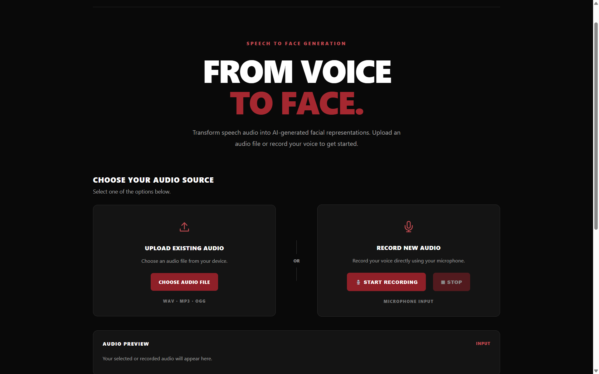
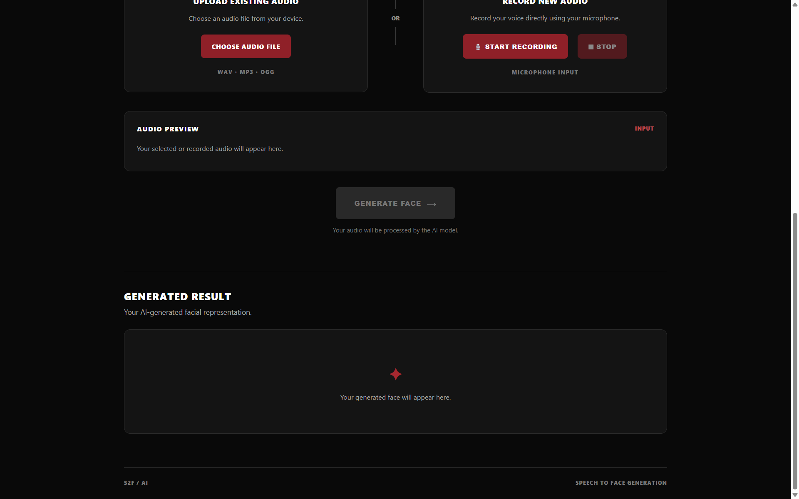

# Speech-to-Face Generation

**An AI-powered web application that generates facial representations from speech audio using Deep Learning.**

Speech-to-Face Generation is a Deep Learning project that explores the relationship between human speech and facial representations. It uses an Audio Spectrogram Transformer (AST) for audio feature extraction and a trained Face Decoder to generate predicted facial representations.

The project combines a trained deep learning pipeline with a Flask-based web interface, allowing users to upload or record audio and generate a visual output directly in their browser.

## Features

- **Audio Upload:** Upload speech recordings in WAV, MP3, OGG, and WEBM formats.
- **Voice Recording:** Record audio directly through your browser.
- **Audio Preview:** Listen to the selected recording before processing.
- **AI-Based Generation:** Process audio using the AST model and trained Face Decoder.
- **Visual Output:** Display the generated facial representation.
- **Temporary File Cleanup:** Automatically delete uploaded audio after processing.
- **Interactive Interface:** Responsive dark-themed web application.

## Technology Stack

| Category | Technologies |
|---|---|
| Programming Language | Python |
| Backend | Flask |
| Deep Learning | PyTorch |
| Audio Feature Extraction | Hugging Face Transformers (AST) |
| Audio Processing | Librosa, SoundFile |
| Visualization | Matplotlib |
| Frontend | HTML, CSS, JavaScript |
| Development | VS Code, Jupyter Notebook |

## Model Architecture

The application follows a multi-stage inference pipeline:

1. **Audio Input:** Accepts an uploaded or browser-recorded speech recording.
2. **Audio Preprocessing:** Normalizes and prepares audio for feature extraction.
3. **Feature Extraction:** Uses the Audio Spectrogram Transformer (AST) to extract audio representations.
4. **Face Decoding:** Passes extracted features through the trained Face Decoder.
5. **Visualization:** Generates and displays the predicted facial representation.

## Project Structure

```text
Speech-To-Face-Generation/
│
├── app.py
├── face_generator.py
├── requirements.txt
├── .gitignore
├── README.md
│
├── models/
│   ├── ast.pt
│   └── face_decoder.pt
│
├── model_source/
│   └── Speech-to-face/
│       └── src/
│           ├── models/
│           ├── data_preprocessing/
│           └── ...
│
├── templates/
│   └── index.html
│
├── static/
│   ├── style.css
│   ├── script.js
│   └── generated/
│
├── uploads/
│
└── S2F_final.ipynb
```

**Note:** The trained model checkpoints are required to run inference but are not included in this repository because of their large file sizes.

## Getting Started

### 1. Clone the Repository

```bash
git clone https://github.com/SOUHARDGUPTA/Speech-To-Face-Generation.git
cd Speech-To-Face-Generation
```

### 2. Create a Virtual Environment

```bash
python -m venv .venv
```

Activate it on Windows PowerShell:

```powershell
.\.venv\Scripts\Activate.ps1
```

### 3. Install Dependencies

```bash
pip install -r requirements.txt
```

PyTorch installation may require a CPU-specific or CUDA-compatible build depending on your system.

### 4. Install FFmpeg

Install FFmpeg separately and make sure its executable is available in your system PATH.

### 5. Add Model Checkpoints

Place the required trained model files inside the `models/` directory:

```text
models/
├── ast.pt
└── face_decoder.pt
```

The checkpoint files are not distributed with this repository. You must obtain the compatible trained checkpoints separately.

### 6. Run the Application

```bash
python app.py
```

Open your browser and visit:

```text
http://127.0.0.1:5000/
```

## Usage

1. Open the web application.
2. Upload an audio recording or record your voice.
3. Preview the selected audio.
4. Click the Generate button.
5. Wait for the AI inference process to finish.
6. View the generated facial representation.

## Research Background

The project explores how speech characteristics can be used to generate facial representations through deep learning.

It uses an Audio Spectrogram Transformer (AST) for audio representation learning and a neural network-based Face Decoder for generating visual representations.

The project also includes a Jupyter Notebook containing the original model implementation and experimentation workflow.

## Limitations

- Generated faces are model predictions, not verified photographs of the actual speaker.
- Speech does not uniquely determine a person's real facial appearance.
- Output quality depends on the training data, model architecture, and trained checkpoints.
- Inference performance depends on available hardware.
- Further evaluation is required to assess generalization across different speakers and recording conditions.

## Future Improvements

- Improve facial representation quality.
- Experiment with additional speech and paired audio-face datasets.
- Evaluate model generalization across different speaker populations.
- Optimize inference speed and resource consumption.
- Explore alternative deep learning architectures.
- Deploy the application as a publicly accessible web service.

## Application Preview

### Homepage


### Audio Input and Generated Result


## Author

**Souhard Gupta**

B.Tech – Mathematics and Computing  
Shri Mata Vaishno Devi University (SMVDU)

GitHub: [@SOUHARDGUPTA](https://github.com/SOUHARDGUPTA)

---

*Developed as a Deep Learning project exploring speech-based facial representation generation.*